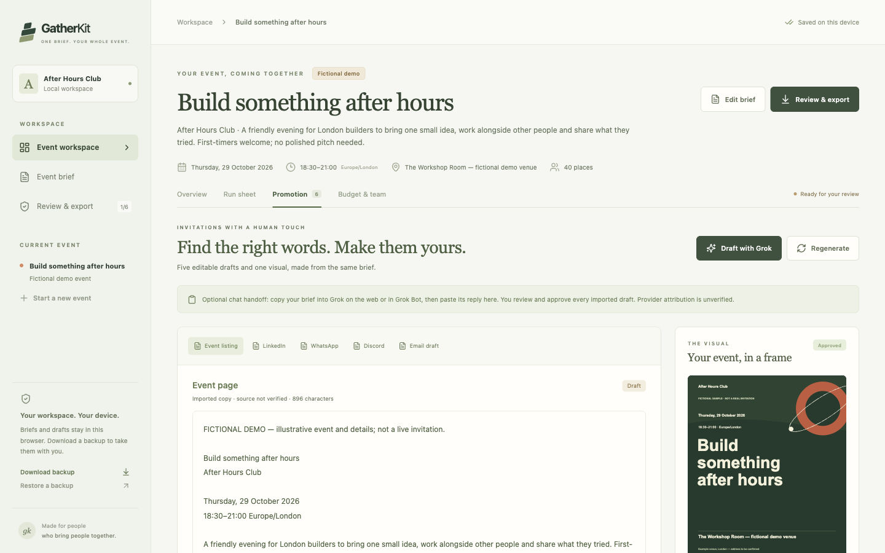

# GatherKit

**One event brief. Your whole event pack.**

GatherKit helps community organisers turn an event idea into an editable plan, five promotional drafts and a poster. Review the details, approve the assets and download a pack for your own publishing workflow.

[Open the app on Vercel](https://gatherkit-eta.vercel.app/) · [Watch the two-minute demo](https://gatherkit-eta.vercel.app/demo.html) · [Download the video](https://gatherkit-eta.vercel.app/gatherkit-demo.mp4)

The player uses a smaller 720p copy for faster loading. The 1080p download remains available. Both versions are exactly two minutes, captioned and without audio.



Built for the Event Autopilot track of the Grok Bot Community Engineering London Hackathon on 22 October 2026. The included After Hours Club example is a **fictional London community and event**. Its venue, contacts, volunteers and costs are illustrative; it is not a live invitation.

## Run locally

Requirements: Node.js 20.19+ or 22.12+ and npm. Clone or download this repository, open its folder and run:

```sh
npm ci
npm run dev
```

Open [http://127.0.0.1:4318](http://127.0.0.1:4318). If that port is occupied, use the address printed by Vite. The local template workflow needs no account, API key or backend. The optional Grok handoff uses your separately signed-in Grok chat.

Run the automated checks and production build:

```sh
npm run check
```

To preview the production build locally:

```sh
npm run build
npm run preview
```

The `dist/` directory is a static website. The included GitHub Actions workflow runs checks and builds the app before deploying `main` to GitHub Pages. In a fork, enable Pages with GitHub Actions as its source.

The public Vercel site is a separate deployment of the static build, including the demo player and video. GitHub pushes do not automatically update Vercel; deploy a fresh `dist/` build to update that site.

## The organiser workflow

1. **Write the brief.** Start with the labelled fictional example or enter your own community, audience, event idea, tone, date, times, venue, accessibility information, registration link, budget and volunteers.
2. **Create the pack.** Local deterministic templates assemble an event page, LinkedIn post, WhatsApp message, Discord announcement and newsletter, plus a poster, run sheet and volunteer rota.
3. **Optionally draft with Grok.** In Promotion, choose **Draft with Grok**. Copy the prepared prompt into a signed-in Grok web chat or Grok Bot conversation, then paste the complete JSON reply back into GatherKit.
4. **Preview and choose.** Check the five returned drafts. GatherKit validates the reply format and checks that it matches the current brief. **Use these drafts** explicitly replaces the five copy assets and resets their approvals; the poster and operational plan remain in place.
5. **Review and approve.** Edit the text, confirm missing details and review the poster. Each copy asset and the poster needs approval. Editing copy resets its approval. Changing the source brief makes the existing pack stale and blocks approved exports until it is regenerated and reviewed.
6. **Export.** Download the approved files, or save a JSON workspace backup at any stage. Publishing happens through your own tools.

GatherKit sends no emails, social posts, calendar invitations or event bookings. Approval records the organiser's review; it does not verify external facts or permissions.

## Features and downloads

- **Shared event context:** one brief supplies the copy, visual and practical plan, with visible missing-detail checks.
- **Editable copy:** five channel drafts, individual approvals and a final review screen.
- **Event artwork:** an original code-generated poster, with SVG and PNG downloads. It uses a fixed template and requires a visual check before sharing; long text may be shortened with an ellipsis.
- **Operations:** an editable timed run sheet and volunteer rota. Changing an assigned person updates matching run-sheet owners.
- **Budget:** GBP costs marked as estimated or confirmed, potential ticket income and a projected balance. Income assumes full capacity; fees, taxes and refunds are excluded.
- **Organiser pack:** Markdown and standalone HTML, including the brief, copy, operations, approval states and imported-copy labels. Print the HTML from a browser if you need a PDF.
- **Calendar:** a tentative `.ics` planning entry for Europe/London, including daylight-saving handling. Other time zones are not supported by this export. Events must start and finish on the same date; ambiguous or nonexistent times around clock changes are rejected.
- **Portable workspace:** local saving and JSON backup/restore, including drafts and approval state. Malformed backups are rejected without replacing the current workspace.
- **Time estimate:** measured local template assembly time and editable preparation/review assumptions. The estimated saving is not measured volunteer time saved and does not measure Grok's response time.

## What the Grok demonstration establishes

On **22 October 2026**, the fictional event prompt was sent to a **signed-in Grok web chat**, which returned five promotional copy assets. Those drafts were imported into GatherKit, checked against the brief, reviewed and approved. The imported copy survived a browser reload, and the export options became available after approval.

The app begins with local deterministic templates. Grok drafting is a **human-assisted prompt-and-reply handoff**, not an embedded API integration. Copying a prompt does not send it anywhere; the user decides when to send it to the separate chat service.

Imported text remains labelled **“Imported copy · source not verified”** because GatherKit cannot independently authenticate who generated pasted text. It validates the structure and matching brief, preserves the fictional-demo requirement and requires fresh copy approval.

Grok Bot desktop authentication was unavailable in the tested environment, so that route remains unverified. There is **no Notion, Ghost, Supabase or Zero integration**, and no automatic publishing connection. The project does not claim sponsor integration or acceptance beyond the demonstrated Grok web handoff.

## Privacy and storage

Workspace data is kept in the browser's local storage. GatherKit does not send it to an application server or model provider. The optional handoff prompt includes public-facing event details and organiser contact information; it excludes internal notes, volunteer names and budget lines. Read the prompt before sending it to Grok.

Local storage belongs to a browser profile and site origin. Other people using that profile may see the workspace, and clearing browser data may remove it. Download a JSON backup for a durable copy or to move between browsers. The app does not provide accounts or live collaborative editing.

Organiser exports and backups can contain contact details, volunteer names and internal notes. Review them before sharing. The fictional label remains in sample-mode outputs. No credentials, session material or API keys belong in this repository or the public app.

## Verification

`npm run check` runs the automated test suite and production build. Tests cover source changes and approvals, imported reply validation, fictional-demo labels, storage validation, budget arithmetic, escaped markup, calendar injection and daylight-saving handling, UTF-8 folding and long poster text.

Browser checks have exercised sample generation, copy-edit approval resets, save/reload persistence, downloads and mobile layouts. Automated tests and local checks do not establish successful hackathon submission, organiser acceptance or an untested external integration.

## Adapt it

Fork the repository, replace the fictional brief and adjust the templates or styling for your community. Keep source labels and organiser review visible. If you add an API provider, keep credentials out of the browser bundle and make its connection state clear.

The source is available under the [MIT licence](LICENSE). The app uses system fonts and code-generated artwork.
